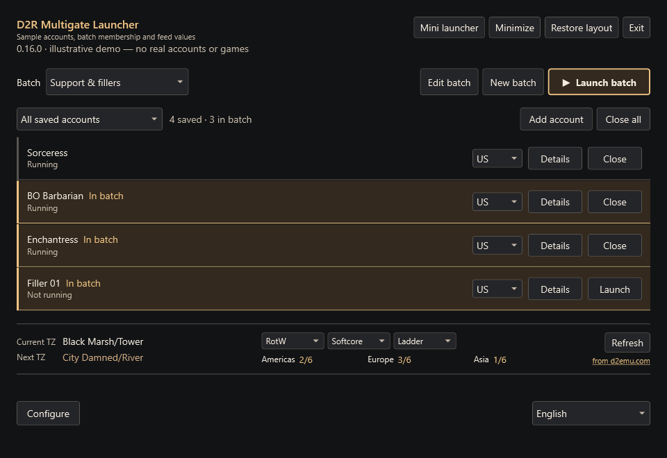
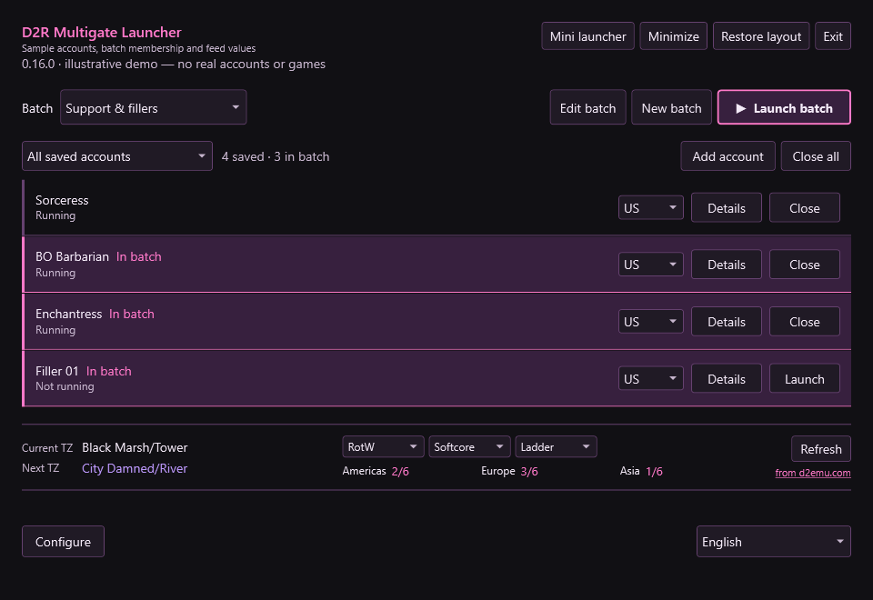
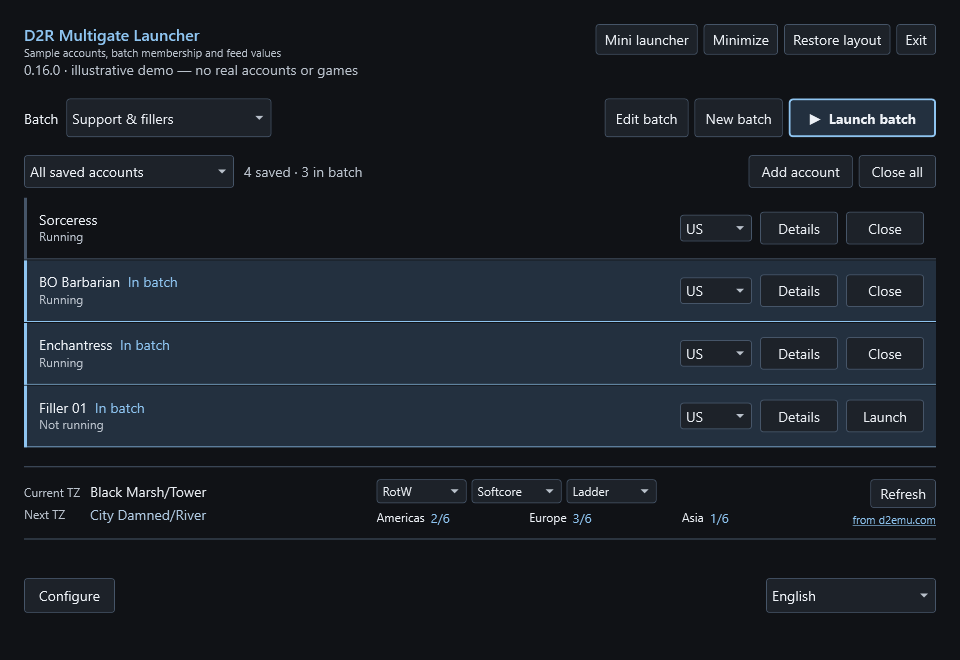
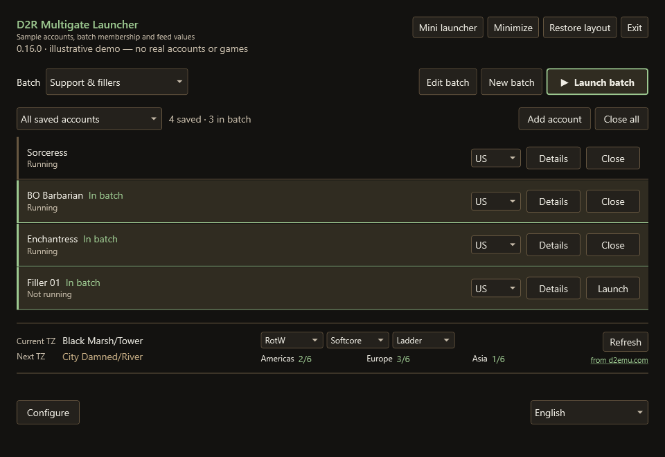
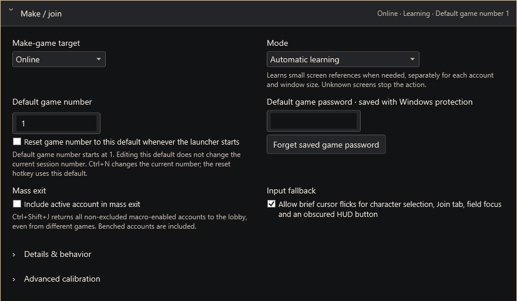
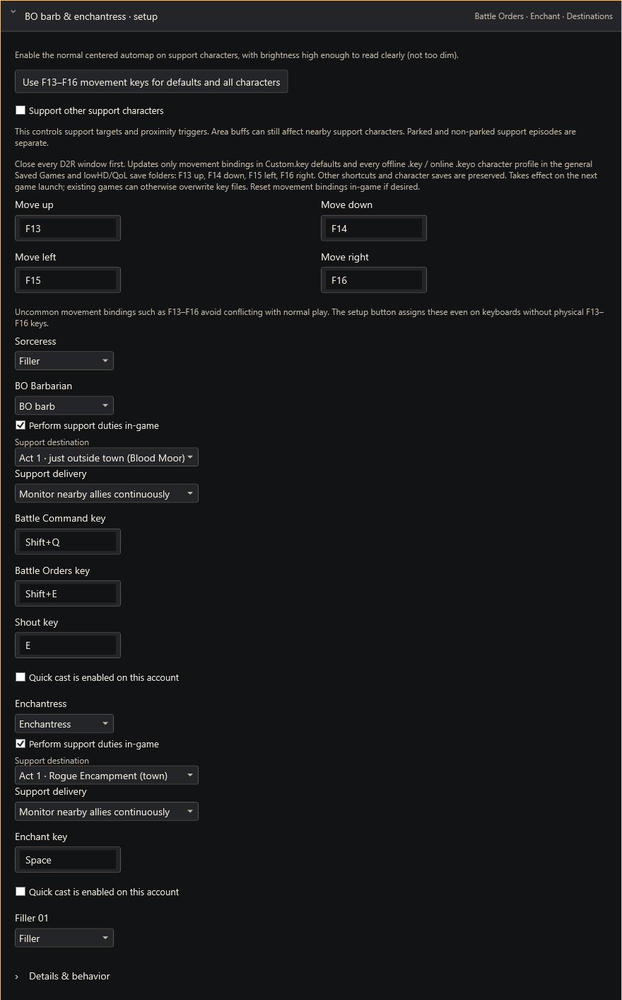

# D2R Multigate Launcher

Launch and manage your D2R accounts, share configurable macros, and set up
lowHD/QoL mods from one self-contained Windows tool.

By **celloboy126**, with Codex.

**[Download the latest release](https://github.com/celloboy126/D2R-Multigate-Launcher/releases/latest)**
— choose **Setup.exe** to install or **Portable.zip** to extract and run.

## lowHD / QoL mod downloads

**Last updated: November 5, 2026.** Download the standalone mods from the **[lowHD/QoL release Assets](https://github.com/celloboy126/lowHD/releases/tag/v2026.11.05)**: [main](https://github.com/celloboy126/lowHD/releases/download/v2026.11.05/lowHDmain.zip), [filler](https://github.com/celloboy126/lowHD/releases/download/v2026.11.05/lowHDfiller.zip), [min](https://github.com/celloboy126/lowHD/releases/download/v2026.11.05/lowHDmin.zip), [partial](https://github.com/celloboy126/lowHD/releases/download/v2026.11.05/lowHDpartial.zip), or [QoL](https://github.com/celloboy126/lowHD/releases/download/v2026.11.05/QoL.zip). The launcher bundles the same verified mod contents.

**Fresh November 5 packages:** all four lowHD variants and QoL were refreshed, including lowHDpartial. Further partial performance tuning is planned. All variants and QoL are planned to be updated shortly after the **Season 16 patch** releases.

## Interface previews

These previews are rendered from the actual interface with **fictional accounts
and sample TZ/D-Clone values**. Running statuses are simulated for demonstration.
No personal account information, private settings or live game screenshots are shown.

| Ember | Portal |
| --- | --- |
|  |  |
| **Moonlight** | **Forest** |
|  |  |

Click an image to view it at full size. Accounts can launch individually or in
batches; batch members are highlighted without changing the row layout.

<strong>See Make/Join and support configuration</strong>

The following panels show generic demo/default settings, not an author's profile.

## Features

- Individual and batch account launching, region selection and shared macros.
- Configurable hotkeys, broadcasting, held input and live clickable thumbnails.
- Online make/join, follow, benching, exclusions and separate offline modes.
- BO support, positioning-only Enchantress and parking, with guarded visual recognition.
- Compact TZ/D-Clone information from [d2emu.com](https://d2emu.com).
- Bundled lowHDmain, lowHDfiller, lowHDmin, lowHDpartial and QoL mods.
- Four dark palettes, twenty interface languages and project-verified updates.

## New in 0.16.3

- Per-account low-resource idle with automatic script/observer wake-up.
- More reliable autonomous parking, title-screen startup, and retries while waiting for the host.
- Live parking timing controls and cleaner account selection.
- Faster repeated follower joins and hardened waypoint-panel recovery.

## New in 0.16.2

- Optional clickable, highlighted account rows that replace the Details button; disabled by default.
- Game window titles can use the original title, launch number, or account label.
- Optional lowHDpartial expansion from already extracted game data; only missing files are copied.
- More reliable parking, improved support routes and background waypoint controls.
- All five November 5 mod packages bundled.

## Getting started

Install **Setup.exe**, or extract **Portable.zip** and run
**D2RMultigateLauncher.exe**. No separate .NET or AutoHotkey installation is needed.
The launcher requests administrator permission for its game-window operations.
Add accounts, set their region and arguments in Details, and launch individually
or by batch. Configure opens expandable settings; the language selector stays at
the lower right. Source-code archives generated automatically by GitHub are not
the launcher download. This public repository contains binaries and documentation.

The five bundled mod packages match the checksum-verified
[lowHD/QoL release](https://github.com/celloboy126/lowHD/releases/tag/v2026.11.05).

## Compatibility and script behavior

Both built-in online make/join modes check visible game screens. Learning uses
small-region pixel/pattern checks and occasional local OCR. Custom deterministic
macros are also available. No game-process memory is read or written, and no game
code is injected. This is not Blizzard approval or a guarantee against enforcement;
read **Configure → How scripts operate** and choose which features to use.

Support navigation has its strongest test coverage at **1920 × 1200**, with a readable normal centered automap and English game UI. Authored town-to-waypoint routes for Acts I–V and all waypoint destinations are enabled, along with Act I just outside town. Other resolutions and destinations still need wider community testing. Enchantress positioning can also stay in towns; **automatic Enchant casting remains disabled**. Changes wait for the next scripted game entry. Town waypoint opening and panel selection use background clicks; the game's own panel-opening cursor shift is immediately reversed. Older interaction fallbacks may briefly borrow the pointer. Unavailable acts/waypoints show an error and select Act I outside for the next game. Make/join has broader calibration support than support navigation.

Language packs include advanced operating help; community review is welcome and
untranslated messages fall back to English.

For offline play, select Offline Hell, Offline Nightmare or Offline Normal.
Normal sends Enter only for characters without a difficulty selector. Switch
back to Online before using an online character.

## Settings and updates

Settings remain in `%APPDATA%\D2RSuite\Preview`. Updates and uninstall preserve
them. Login secrets use the current Windows user's protection and do not transfer
automatically to another Windows account or computer. Game files change only
through the corresponding mod install or extracted-data operation.

The launcher checks for updates at startup and shows brief change notes. Updates
require a project-signed manifest and matching installer SHA-256. This is separate
from Windows Authenticode signing: Windows may show **Unknown publisher** because
there is no commercial Windows publisher certificate. Download the initial copy
only from this project's official releases; no security settings need disabling.
Uninstall removes launcher files and shortcuts, not profiles, game files or mods.

## Contact and credits

**Discord:** [celloboy126](https://discord.com/users/754143383978508379)
for suggestions, bug reports and language requests. Include version, mod,
resolution, action and error text; never post passwords, login tokens or profiles.

Built by celloboy126 on jsp / Nexus Mods / Traderie, with Codex. Inspired by
shupershuff's D2R launcher, Gimli's Tinymod, mininexus mod, numerous modders on
inven. Third-party notices are included in the package's `licenses`.

Optional support: [Venmo @celloboy126](https://venmo.com/celloboy126).

## Optional lowHDpartial expansion

After installing partial and extracting game data, use **Configure → lowHD / QoL mods → Copy extracted data into lowHDpartial**. The launcher previews missing-file count and disk space. It copies from `Data/global`, `Data/hd` and `Data/local`, preserving every existing partial asset, empty override and mod build marker. No other mod is expanded. Launch with `-mod lowHDpartial`; `-direct` is not needed. This can use tens of GB of additional disk space. A permitted bundled-mod update replaces the mod folder, so update extracted data and repeat the copy afterward. Loading improvements depend on storage and the assets being used.
