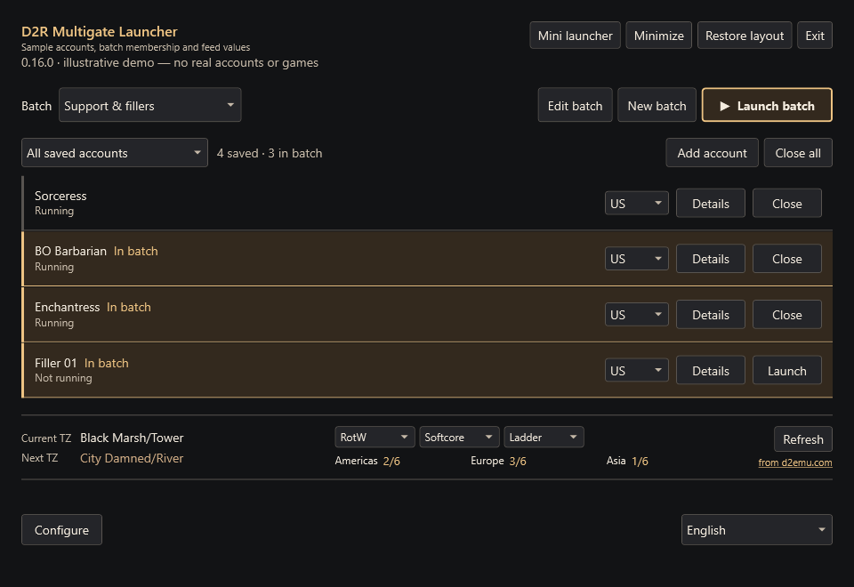
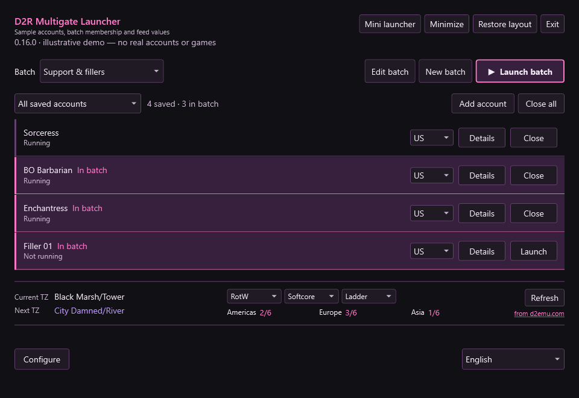
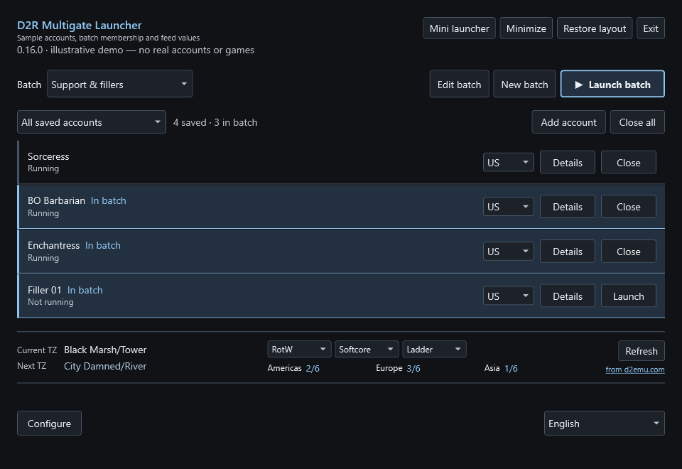
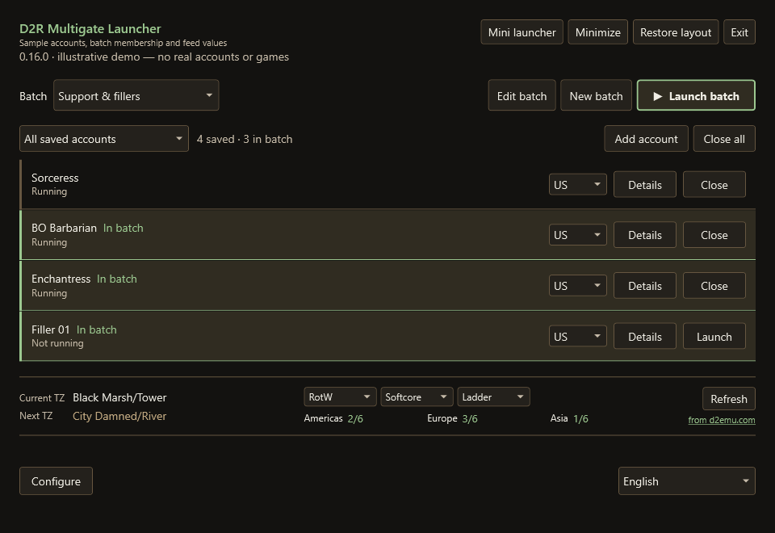
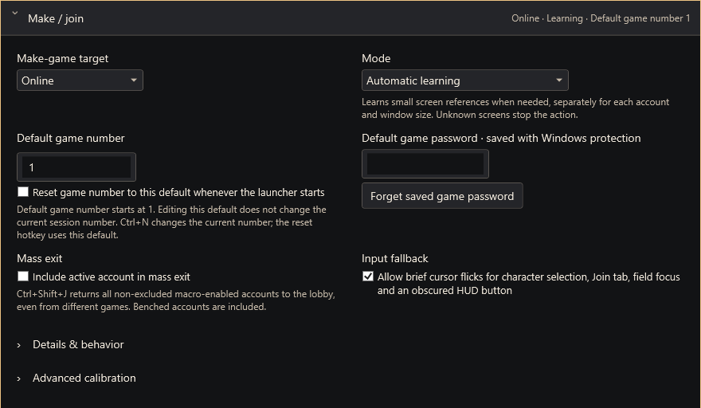
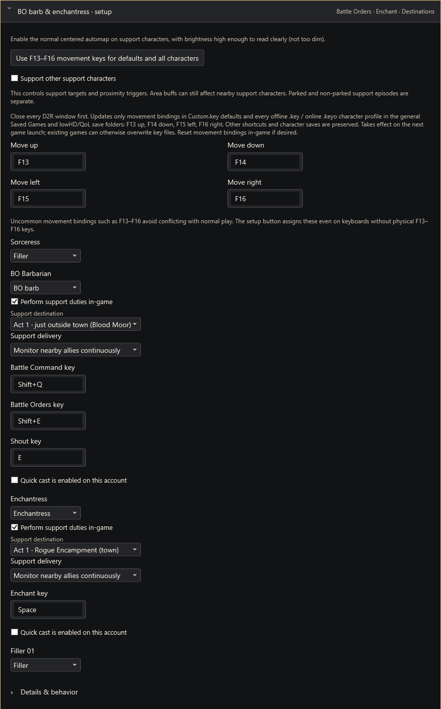

# D2R Multigate Launcher

Launch and manage your D2R accounts, share configurable macros, and set up
lowHD/QoL mods from one self-contained Windows tool.

By **celloboy126**, with Codex.

**[Download the latest release](https://github.com/celloboy126/D2R-Multigate-Launcher/releases/latest)**
— choose **Setup.exe** to install or **Portable.zip** to extract and run.

## Interface previews

These previews are rendered from the actual interface with **fictional accounts
and sample TZ/D-Clone values**. Running statuses are simulated for demonstration.
No personal account information, private settings or live game screenshots are shown.

| Ember | Portal |
| --- | --- |
|  |  |
| **Moonlight** | **Forest** |
|  |  |

Click an image to view it at full size. Accounts can launch individually or in
batches; batch members are highlighted without changing the row layout.

<strong>See Make/Join and support configuration</strong>

The following panels show generic demo/default settings, not an author's profile.

## Features

- Individual and batch account launching, region selection and shared macros.
- Configurable hotkeys, broadcasting, held input and live clickable thumbnails.
- Online make/join, follow, benching, exclusions and separate offline modes.
- BO/Enchant support and parking, with guarded visual recognition.
- Compact TZ/D-Clone information from [d2emu.com](https://d2emu.com).
- Bundled lowHDmain, lowHDfiller, lowHDmin, lowHDpartial and QoL mods.
- Four dark palettes, twenty interface languages and project-verified updates.

## Getting started

Install **Setup.exe**, or extract **Portable.zip** and run
**D2RMultigateLauncher.exe**. No separate .NET or AutoHotkey installation is needed.
The launcher requests administrator permission for its game-window operations.
Add accounts, set their region and arguments in Details, and launch individually
or by batch. Configure opens expandable settings; the language selector stays at
the lower right. Source-code archives generated automatically by GitHub are not
the launcher download. This public repository contains binaries and documentation.

The five bundled mod packages match the checksum-verified
[lowHD/QoL release](https://github.com/celloboy126/lowHD/releases/tag/v2026.10.27).

## Compatibility and script behavior

Both built-in online make/join modes check visible game screens. Learning uses
small-region pixel/pattern checks and occasional local OCR. Custom deterministic
macros are also available. No game-process memory is read or written, and no game
code is injected. This is not Blizzard approval or a guarantee against enforcement;
read **Configure → How scripts operate** and choose which features to use.

Support travel currently requires the tested **1920 × 1200, normal centered
automap, readable brightness and English game UI**. Unknown routes stop safely.
Only validated Act I outside-town variants and Act IV outside-town are enabled;
other layouts/routes remain deferred. Some non-town waypoint retargeting can stop
when the hit location cannot be confirmed. See release notes for current limits.
These support limits do not describe make/join's broader calibration support.
Language packs include advanced operating help; community review is welcome and
untranslated messages fall back to English.

For offline play, select Offline Hell, Offline Nightmare or Offline Normal.
Normal sends Enter only for characters without a difficulty selector. Switch
back to Online before using an online character.

## Settings and updates

Settings remain in `%APPDATA%\D2RSuite\Preview`. Updates and uninstall preserve
them. Login secrets use the current Windows user's protection and do not transfer
automatically to another Windows account or computer. Game files change only
through the corresponding mod install or extracted-data operation.

The launcher checks for updates at startup and shows brief change notes. Updates
require a project-signed manifest and matching installer SHA-256. This is separate
from Windows Authenticode signing: Windows may show **Unknown publisher** because
there is no commercial Windows publisher certificate. Download the initial copy
only from this project's official releases; no security settings need disabling.
Uninstall removes launcher files and shortcuts, not profiles, game files or mods.

## Contact and credits

**Discord:** [celloboy126](https://discord.com/users/754143383978508379)
for suggestions, bug reports and language requests. Include version, mod,
resolution, action and error text; never post passwords, login tokens or profiles.

Built by celloboy126 on jsp / Nexus Mods / Traderie, with Codex. Inspired by
shupershuff's D2R launcher, Gimli's Tinymod, mininexus mod, numerous modders on
inven, and Kemito. Third-party notices are included in the package's `licenses`.

Optional support: [Venmo @celloboy126](https://venmo.com/celloboy126).
